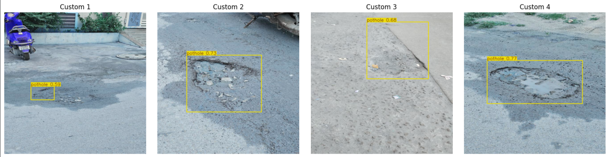
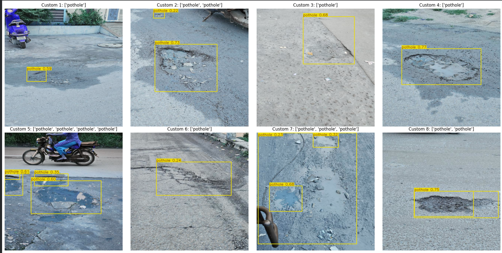
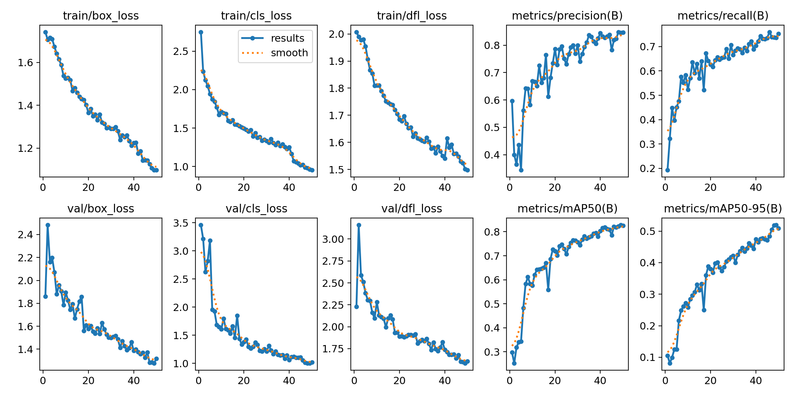
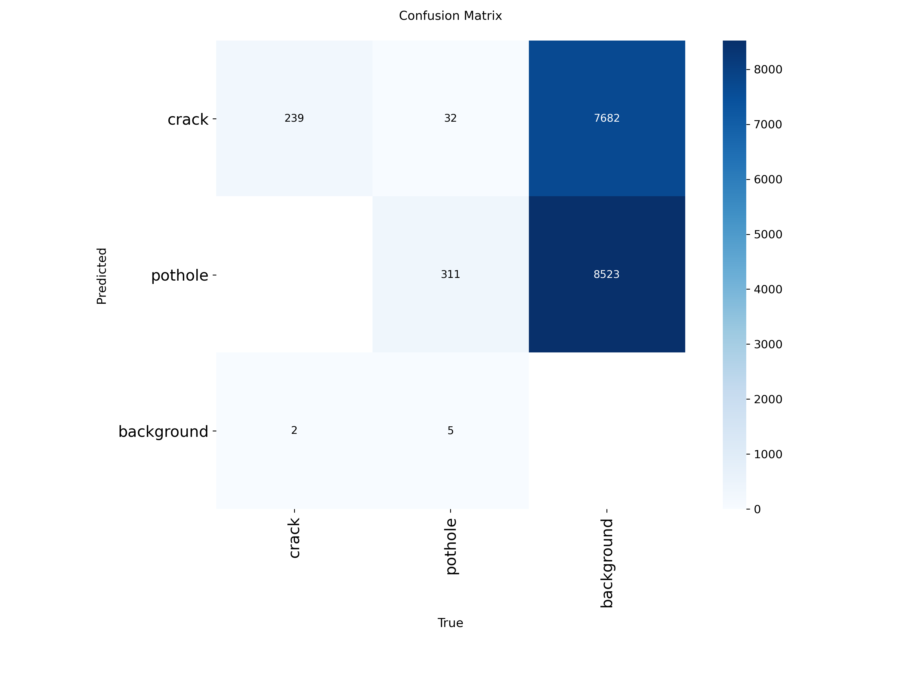

# 🛣️ RoadGuard Vision Lab
### YOLOv11-Based Pavement Distress Detection

RoadGuard Vision Lab is a computer vision project that detects **road cracks and potholes** from images using a YOLOv11n object detection model. It combines a trained deep learning model with an interactive Gradio web interface to visualize predictions and explore pavement distress detection.

🔗 **Live Demo:** [Try RoadGuard Vision Lab on Hugging Face](https://huggingface.co/spaces/Lirisha123/roadguard-vision-lab)

---

## 📌 Table of Contents

- [Project Overview](#-project-overview)
- [Features](#-features)
- [Project Screenshots](#-project-screenshots)
- [Model Performance](#-model-performance)
- [Key Novelties](#-key-novelties)
- [Model Configuration](#-model-configuration)
- [Technology Stack](#-technology-stack)
- [Installation and Usage](#-installation-and-usage)
- [Field Testing](#-field-testing)
- [Limitations](#-limitations)
- [Future Improvements](#-future-improvements)
- [Author](#-author)

## 🎯 Project Overview

Road surface damage can create road safety risks and increase infrastructure maintenance requirements. Manually inspecting roads can be time-consuming, motivating the use of computer vision to assist with identifying visible pavement distress.

RoadGuard uses object detection to locate cracks and potholes in road images. Users can upload an image through the web interface and view the predicted bounding boxes and detected classes.

**Project goal:** Develop and demonstrate a lightweight AI-based approach to pavement distress detection.

## ✨ Features

- **Crack detection:** Identifies visible road cracks.
- **Pothole detection:** Identifies visible potholes.
- **Interactive web interface:** Upload road images and view model predictions.
- **Adjustable confidence threshold:** Control which predictions are displayed.
- **Visual evaluation evidence:** Includes training results, a confusion matrix, and saved detection examples.
- **Lightweight model:** Uses YOLOv11n for object detection.

## 📸 Project Screenshots

### Detection Example 1



### Detection Example 2



### Training Results



### Confusion Matrix



*The images above are saved project outputs. Screenshots of the live web interface can also be added here to demonstrate the complete user experience.*

## 📊 Model Performance

The following are the reported validation metrics for the trained model.

| Evaluation Metric | Result |
|---|---:|
| Precision | 0.845 |
| Recall | 0.736 |
| mAP@50 | 0.828 |
| mAP@50–95 | 0.520 |
| Crack mAP@50 | 0.880 |
| Pothole mAP@50 | 0.776 |

During development, the reported validation mAP@50 improved from **0.564 to 0.828**.

These results reflect validation performance. They should not be interpreted as guaranteed accuracy on unseen road images or as results measured on the separate field-test collection.

## 🚀 Key Novelties and Contributions

### 1. Hard-Negative Mining

Incorporated background images with empty labels to expose the detector to scenes without target distress objects. This helps the model learn to distinguish relevant road damage from ordinary road surfaces and other background content.

### 2. Targeted Data Augmentation

Tuned augmentation settings to help the model handle visual variations in road images.

| Augmentation | Setting |
|---|---:|
| HSV value | 0.4 |
| HSV saturation | 0.5 |
| Rotation | 15° |
| Horizontal flip probability | 0.5 |

### 3. Validation-Led Model Improvement

Compared model performance during development and tracked the reported increase in validation mAP@50 from 0.564 to 0.828.

### 4. Lightweight Inference Pipeline

Used YOLOv11n, a compact object detection model, with an interactive Gradio application for image-based inference.

### 5. Separate Field-Test Image Collection

Collected 183 real smartphone road photos for separate field testing. This collection was kept separate from model training. It provides a basis for examining performance on real-world images beyond the training dataset.

## ⚙️ Model Configuration

| Parameter | Configuration |
|---|---|
| Model architecture | YOLOv11n |
| Task | Object detection |
| Target classes | Crack, pothole |
| Training epochs | 50 |
| Batch size | 16 |
| Input image size | 640 × 640 |
| Training hardware | NVIDIA Tesla T4 |
| Reported checkpoint size | Approximately 5.5 MB |
| Reported parameter count | Approximately 2.58 million |

## 🛠️ Technology Stack

- **Python** — application and model integration
- **Ultralytics YOLO** — object detection
- **Gradio** — interactive web interface
- **Pillow** — image handling
- **Hugging Face Spaces** — deployment and hosting

## 💻 Installation and Usage

### Prerequisites

- Python installed on your system
- The project source files
- The trained `best.pt` model checkpoint

### 1. Clone the repository

```bash
git clone https://github.com/Lirisha123/roadgurad-vision.git
cd roadgurad-vision
```

### 2. Install dependencies

```bash
pip install -r requirements.txt
```

### 3. Check the project files

Ensure `app.py`, `requirements.txt`, and `best.pt` are available in the project root.

### 4. Run the application

```bash
python app.py
```

Open the local URL displayed in the terminal to use the Gradio interface.

**Note:** The application uses a GPU execution decorator for Hugging Face ZeroGPU. Running it locally may require adapting the GPU-specific code and configuring a compatible inference device.

## 🧪 Field Testing

A separate collection of **183 real smartphone road photos** was gathered for field testing. These images were not used to train the model.

The collection is intended to support evaluation under real-world image conditions. The validation metrics listed above are not field-test results, and no field-test performance figures are claimed here.

## ⚠️ Limitations

- Detection performance can vary with lighting, image quality, road texture, and camera angle.
- Shadows, road markings, surface patches, and other visual patterns may cause false detections or missed damage.
- Validation metrics do not guarantee equivalent performance on every unseen road image.
- The system is a computer vision demonstration and should not be treated as a replacement for professional road inspection.

## 🔮 Future Improvements

- Evaluate the model quantitatively on the separate field-test collection.
- Improve robustness across lighting, weather, and road surface conditions.
- Expand the dataset to include more diverse road damage examples.
- Explore integration with road maintenance reporting and inspection workflows.
- Investigate model optimization for faster inference on edge devices.

## 👩‍💻 Author

**Lirisha Reddy**

- GitHub: [@Lirisha123](https://github.com/Lirisha123)
- Project repository: [roadgurad-vision](https://github.com/Lirisha123/roadgurad-vision)
- Live demo: [RoadGuard Vision Lab](https://huggingface.co/spaces/Lirisha123/roadguard-vision-lab)

---

*RoadGuard Vision Lab — applying computer vision to pavement distress detection.*
